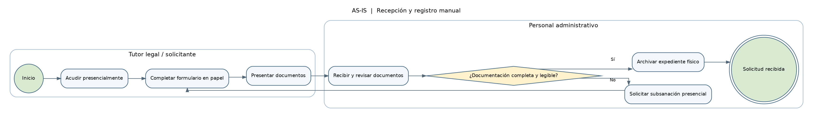
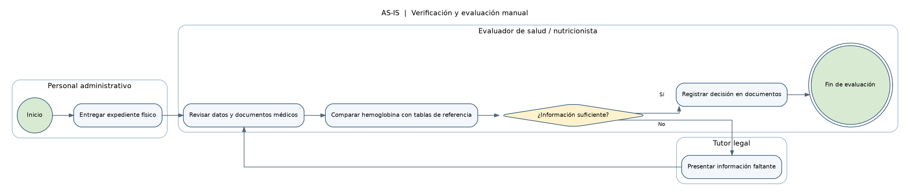
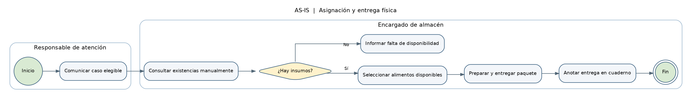
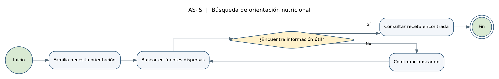
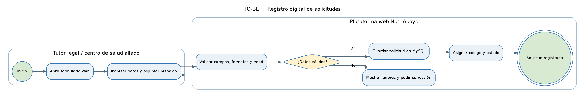
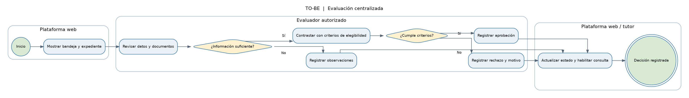
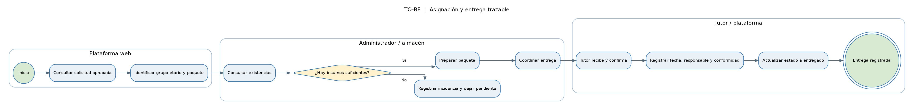
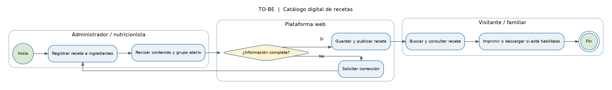
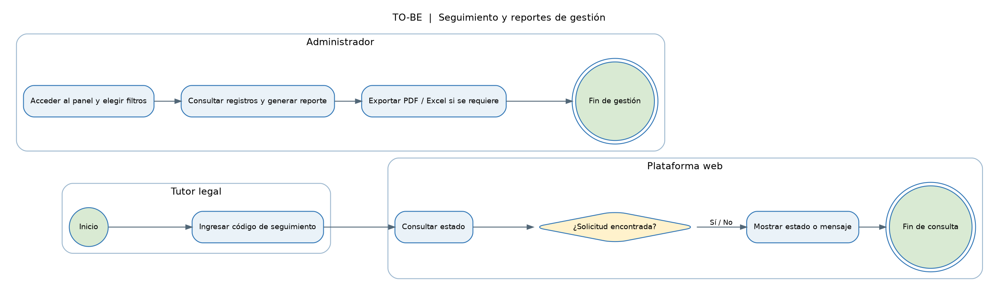

# CAPÍTULO 3: DISEÑO DEL SISTEMA PROPUESTO

## 3.1. Modelamiento de procesos de negocio

El modelamiento de procesos de negocio permite describir el funcionamiento actual de NutriApoyo y establecer cómo se desarrollarán sus actividades mediante el sistema web propuesto. Para ello, se presentan los procesos en dos perspectivas: AS-IS, que representa la situación actual, y TO-BE, que describe el funcionamiento esperado después de incorporar la solución tecnológica.

La propuesta busca centralizar el registro de solicitudes, facilitar la evaluación documental, mejorar el control de los paquetes nutricionales, organizar el catálogo de recetas y permitir el seguimiento de la atención. Las decisiones relacionadas con la elegibilidad de los beneficiarios continúan bajo responsabilidad del personal autorizado.

### 3.1.1. Listado de procesos relevantes

| N.º | Proceso | Descripción general |
|---|---|---|
| 1 | Recepción y registro de solicitudes | Recopilación de los datos del menor y del tutor legal, información médica declarada y documentos de respaldo para solicitar apoyo nutricional. |
| 2 | Verificación y evaluación de solicitudes | Revisión de los datos y documentos presentados para determinar si la solicitud cumple los criterios de elegibilidad establecidos. |
| 3 | Asignación y entrega de paquetes nutricionales | Verificación de la disponibilidad de insumos, asignación del paquete correspondiente y registro de la entrega al beneficiario. |
| 4 | Gestión y consulta del catálogo de recetas | Registro, actualización y consulta de recetas nutricionales para brindar orientación alimentaria a los usuarios. |
| 5 | Seguimiento y control de la atención | Consulta del estado de las solicitudes y generación de reportes administrativos sobre la atención registrada. |

**Alcance del modelamiento:** el sistema está dirigido a menores de 0 a 15 años en Piura que requieren apoyo nutricional por diagnóstico o riesgo de anemia. La solicitud puede ser presentada por el tutor legal o por personal autorizado de un centro de salud aliado, según el alcance definido para el proyecto.

Se contempla la evaluación por personal autorizado, la asignación y entrega trazable de paquetes nutricionales y el acceso a un catálogo de recetas. No se contempla el diagnóstico clínico automatizado, la prescripción médica, la gestión de campañas de donación, la administración de voluntarios ni la integración con sistemas externos.

### 3.1.2. Modelado del estado actual de los procesos (AS-IS)

Los procesos actuales se caracterizan por el uso de formularios físicos, revisión manual de documentos y registros dispersos. Estas actividades pueden dificultar la consulta de información, el seguimiento de solicitudes y la trazabilidad de las entregas.

#### 3.1.2.1. Recepción y registro manual de solicitudes

**Descripción:** el tutor legal acude presencialmente y proporciona los datos del menor mediante un formulario físico. El personal administrativo recibe la documentación y comprueba manualmente que los campos estén completos y que los documentos sean legibles. Si encuentra información faltante, solicita su subsanación. Cuando la documentación está completa, se archiva el expediente para continuar con la evaluación.

**Actores involucrados:**
- Tutor legal o solicitante.
- Personal administrativo.

**Limitaciones identificadas:** dependencia de documentos físicos, posibilidad de errores de transcripción, dificultad para localizar expedientes y ausencia de una consulta digital inmediata del estado de la solicitud.

**Diagrama BPMN AS-IS:**

#### 3.1.2.2. Verificación y evaluación manual de solicitudes

**Descripción:** el personal administrativo deriva el expediente al evaluador de salud o nutricionista. El evaluador revisa la información proporcionada y los documentos médicos disponibles, y compara los datos con los criterios de referencia aplicables. Si identifica información incompleta, solicita su subsanación. Finalmente, registra la decisión en los documentos físicos correspondientes.

**Actores involucrados:**
- Personal administrativo.
- Evaluador de salud o nutricionista.
- Tutor legal, cuando se requiere subsanación.

**Limitaciones identificadas:** revisión manual de expedientes, demora en la comunicación de resultados y dificultad para consultar el historial de evaluaciones.

**Diagrama BPMN AS-IS:**

#### 3.1.2.3. Asignación y entrega manual de paquetes nutricionales

**Descripción:** una vez autorizada la atención, el personal responsable revisa los insumos disponibles y determina el paquete que puede entregarse al beneficiario. La entrega se registra manualmente, por ejemplo, en cuadernos o documentos físicos. La consulta posterior de las existencias y de las entregas depende de la disponibilidad y actualización de dichos registros.

**Actores involucrados:**
- Personal administrativo autorizado.
- Encargado de almacén.
- Tutor legal o receptor del paquete.

**Limitaciones identificadas:** riesgo de inconsistencias en los registros de inventario, dificultad para verificar entregas anteriores y limitada trazabilidad de los paquetes asignados.

**Diagrama BPMN AS-IS:**

#### 3.1.2.4. Gestión y consulta de recetas nutricionales

**Descripción:** la orientación nutricional se proporciona mediante información disponible en documentos u otros materiales. Al no existir un catálogo digital estructurado y centralizado en el proceso descrito, la búsqueda y actualización de recetas puede depender de la disponibilidad de los materiales utilizados por el personal.

**Actores involucrados:**
- Personal responsable de la orientación nutricional.
- Tutor legal o usuario que consulta la información.

**Limitaciones identificadas:** dificultad para centralizar las recetas, mantener su contenido actualizado y facilitar su consulta por parte de los usuarios.

**Diagrama BPMN AS-IS:**

### 3.1.3. Modelado de los procesos optimizados o creados (TO-BE)

Los procesos TO-BE representan el funcionamiento esperado mediante la plataforma web NutriApoyo. La solución propone centralizar la información y facilitar el registro, la evaluación, la asignación de paquetes, la consulta de recetas y el seguimiento administrativo.

Los diagramas representan el diseño propuesto y no implican que todas las funcionalidades estén implementadas actualmente.

#### 3.1.3.1. Registro digital de solicitudes

**Descripción:** el tutor legal o personal autorizado de un centro aliado completa el formulario digital. La plataforma valida los campos obligatorios, los formatos y las reglas definidas para los datos ingresados. Si existen errores, solicita la corrección de la información. Si los datos son válidos, registra la solicitud, asigna un identificador y establece su estado inicial.

**Actores involucrados:**
- Tutor legal o solicitante autorizado.
- Plataforma web NutriApoyo.
- Personal administrativo, cuando corresponda.

**Cambios respecto al proceso AS-IS:**
- Sustitución del formulario físico por un formulario digital.
- Validación de los datos antes del registro.
- Centralización de la información.
- Identificación de la solicitud para facilitar su seguimiento.

**Requerimientos relacionados:** RF-01, RF-02, RF-03 y RF-07.

**Diagrama BPMN TO-BE:**

#### 3.1.3.2. Evaluación centralizada de solicitudes

**Descripción:** el evaluador accede a una bandeja de solicitudes pendientes y consulta los datos y documentos registrados. La plataforma puede apoyar la comprobación de los criterios de elegibilidad definidos, sin sustituir el juicio profesional. El evaluador registra la aprobación, observación o rechazo de la solicitud. Cuando se requiere subsanación, la solicitud queda observada para que se corrija la información y pueda volver a evaluarse.

**Actores involucrados:**
- Evaluador de salud o nutricionista.
- Plataforma web NutriApoyo.
- Tutor legal o solicitante.
- Personal administrativo autorizado.

**Cambios respecto al proceso AS-IS:**
- Consulta centralizada de solicitudes.
- Registro digital del resultado de la evaluación.
- Mejor seguimiento de solicitudes observadas.
- Disponibilidad del estado registrado para su consulta.

**Requerimientos relacionados:** RF-07, RF-08, RF-09, RF-10, RF-11 y RF-12.

**Diagrama BPMN TO-BE:**

#### 3.1.3.3. Asignación y entrega de paquetes nutricionales

**Descripción:** el personal autorizado consulta la disponibilidad de los paquetes e insumos registrados. Según la elegibilidad del beneficiario, el grupo etario definido y las existencias disponibles, se asigna el paquete correspondiente. Posteriormente, se registra la entrega y se actualiza la información de control para conservar la trazabilidad.

Si no existen insumos disponibles, la atención debe quedar pendiente o gestionarse según las reglas que defina el proyecto, sin registrar una entrega que no se haya realizado.

**Actores involucrados:**
- Personal administrativo autorizado.
- Encargado de almacén.
- Plataforma web NutriApoyo.
- Tutor legal o receptor del paquete.

**Cambios respecto al proceso AS-IS:**
- Consulta centralizada de paquetes e inventario.
- Registro digital de la asignación.
- Registro de la entrega realizada.
- Mayor trazabilidad de las atenciones.

**Requerimientos relacionados:** RF-13, RF-14, RF-15 y RF-16.

**Diagrama BPMN TO-BE:**

#### 3.1.3.4. Gestión y consulta del catálogo de recetas

**Descripción:** el personal autorizado registra y mantiene las recetas nutricionales en el catálogo digital. Los usuarios pueden consultar las recetas disponibles y utilizar los filtros de búsqueda definidos por el sistema. La plataforma presenta la información registrada para facilitar el acceso a contenidos de orientación nutricional.

**Actores involucrados:**
- Personal autorizado para gestionar recetas.
- Tutor legal o visitante.
- Plataforma web NutriApoyo.

**Cambios respecto al proceso AS-IS:**
- Centralización de las recetas en un catálogo digital.
- Mantenimiento organizado de la información.
- Consulta y búsqueda desde la plataforma.
- Mayor accesibilidad a los contenidos nutricionales.

**Requerimientos relacionados:** RF-18 y RF-19, además de los requerimientos de publicación o consulta que estén definidos en la documentación vigente.

**Diagrama BPMN TO-BE:**

#### 3.1.3.5. Seguimiento de solicitudes y reportes de gestión

**Descripción:** el tutor ingresa el código de seguimiento para consultar el estado de su solicitud. La plataforma busca el registro y muestra el resultado disponible o un mensaje cuando no se encuentra la solicitud. Por su parte, el administrador autorizado accede a los registros centralizados, selecciona los filtros disponibles y consulta los reportes de solicitudes, evaluaciones y entregas registrados.

La disponibilidad de exportación a PDF o Excel dependerá de que esa funcionalidad esté contemplada e implementada en el sistema.

**Actores involucrados:**
- Tutor legal.
- Administrador autorizado.
- Plataforma web NutriApoyo.

**Cambios respecto al proceso AS-IS:**
- Consulta digital del estado de la solicitud.
- Centralización de la información administrativa.
- Mayor facilidad para revisar los registros de atención.
- Posibilidad de generar reportes según las funcionalidades desarrolladas.

**Requerimientos relacionados:** RF-07 y los requerimientos de reportes definidos en la documentación del proyecto.

**Diagrama BPMN TO-BE:**

### Consideraciones finales del modelamiento

El diseño propuesto busca mejorar la organización y trazabilidad de las solicitudes, evaluaciones, paquetes nutricionales y recetas mediante una plataforma web centralizada. La automatización se limita a las validaciones y tareas que correspondan a las reglas del sistema; las decisiones de elegibilidad siguen siendo responsabilidad del personal autorizado.

La asignación y entrega de paquetes dependen de la disponibilidad real de los insumos y de los registros efectuados. El modelamiento no contempla diagnóstico clínico automatizado, prescripción médica, optimización de rutas, compras automáticas, gestión de campañas de donación ni integraciones externas.
  
